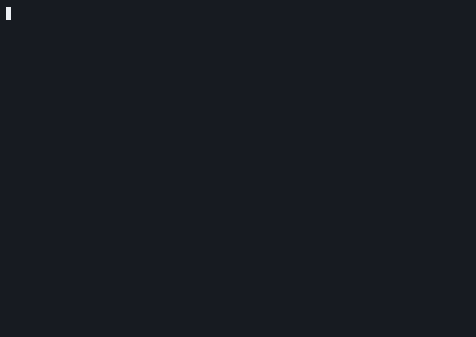

# wordle_c

A terminal Wordle written in C with a full-screen color TUI. While the package was originally designed for UNIX-like systems, it can be compiled and played on any terminal that supports ANSI escape codes. This repository began as a summer project, but later became a test case for Local Large Language Model use (Qwen-3.8-Flash-Next IQ3_S via the Strata Inference engine) after we both realized that'd we'd never have time to finish it manually. It's a fun, self-contained piece of code.

## How to install

First, clone the repository:
```
git clone https://github.com/michaeldunnpro/wordle_c.git
```
Move into the cloned repository. From there, you can either invoke 
```
make run
```
to run the program directly, or invoke
```
sudo make install
```
to create a symbolic link between the cloned repository and /usr/local/bin on most Unix-like systems. Then, you can invoke 
```
wordle_c
```
from anywhere on the system to play easily from the terminal. That's it -- there are no external dependencies outside of the C standard library.

## Uninstall

You can clean out compiled executables by running 
```
make clean
```
from inside the cloned folder. If you've installed a symlink, you'll need 
to run 
```
sudo make clean
```
instead.

## Make targets

| Target      | What it does                                          |
| ----------- | ----------------------------------------------------- |
| `all`       | Build with `-Wall -Werror` into `bin/wordle_c`         |
| `run`       | Build and play                                        |
| `install`   | Symlink `wordle_c` into `/usr/local/bin` (needs `sudo`) so it plays from any directory; for a user-local install use `INSTALL_DIR=$HOME/.local/bin` |
| `sanitize`  | Build with AddressSanitizer + UBSan (`bin/wordle_c-san`) |
| `check`     | Run scripted win/loss/invalid-input/EOF games under the sanitizers |
| `valgrind`  | Run those same games under Valgrind; leaks fail the run |
| `clean`     | Remove build artifacts and the launcher link          |
| `format`    | Run clang-format (if installed)                       |

## Layout

- `src/main.c` — game loop, input handling, replay flow
- `src/tui.h/.c` — screen rendering (board, keyboard legend, status)
- `src/game.h/.c` — round logic and word-bank validation
- `src/matcher.h/.c` — Wordle green/yellow/gray matching
- `src/color_print.h/.c` — ANSI colour primitives and palette
- `src/word_bank.h/.c` — official answer and guess lists
